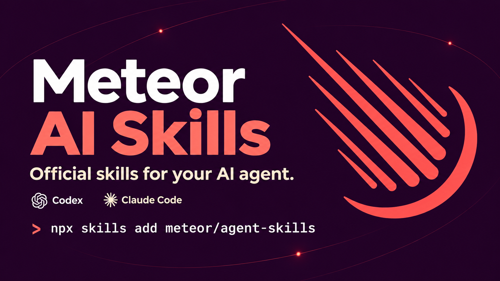

# meteor/agent-skills

[](#install)

Agent Skills for AI assistants helping developers build, debug, migrate, and operate **Meteor 3 applications**.

> Status: stable. Seventeen Meteor 3 skills are available in the current catalog.

See [the changelog](./CHANGELOG.md) for additions and updates.

[Version 1.1.1](https://github.com/meteor/agent-skills/releases/tag/v1.1.1)
updates guidance for Meteor 3.6.1, 3.5.5 and 3.4.4, including Accounts security,
authenticated fetch, Mongo query fallbacks and native rebuilds. Earlier Meteor 3
compatibility branches remain explicit. See the [verification handoff](./docs/releases/v1.1.1.md).

## Install

The GitHub installation commands below require a public repository. Maintainers
can test the working tree while it remains private by following
[`RELEASING.md`](./RELEASING.md#test-the-plugin-locally).

### Codex

Install the complete catalog as one Codex plugin:

```bash
codex plugin marketplace add meteor/agent-skills
codex plugin add meteor@meteor
```

To install the official release, pin the marketplace checkout to its
repository tag:

```bash
codex plugin marketplace add meteor/agent-skills --ref v1.1.1
codex plugin add meteor@meteor
```

### Claude Code

Install the complete catalog as one Claude Code plugin:

```bash
claude plugin marketplace add meteor/agent-skills
claude plugin install meteor@meteor
```

To install the official release, append its repository tag to the marketplace
source:

```bash
claude plugin marketplace add meteor/agent-skills#v1.1.1
claude plugin install meteor@meteor
```

### Individual skills and other agents

The open `skills` CLI installs individual skills or the complete catalog into
Claude Code, Cursor, Codex, Copilot, Gemini CLI, OpenCode, and other supported
agents. Use this route when you want only selected skills instead of the full
Meteor plugin.

Requires Node.js 22.20.0 or later in the shell running `npx`, as specified by
[Skills CLI](https://github.com/vercel-labs/skills#install-a-skill). This is an
installer requirement; your Meteor application can keep its own Node version.
For Node 20 or early Node 22, see [Older Node versions](#older-node-versions).

Run this from your project directory to select skills from the default branch:

```bash
npx skills add meteor/agent-skills
```

To install the official release, pin the catalog tag:

```bash
npx skills add 'meteor/agent-skills#v1.1.1'
```

Reinstalling replaces the selected existing skill directories, leaving
unselected skills in place. Restart your agent after installation.

```bash
# one skill
npx skills add meteor/agent-skills --skill migrate-to-meteor-3

# every published skill for Codex, non-interactive
npx skills add meteor/agent-skills --agent codex --yes
```

Already installed? See [Manage an installation](#manage-an-installation).

The public [installation smoke checks](https://github.com/meteor/agent-skills/actions/workflows/install-smoke.yml)
exercise the unpinned command on Node 22.20.0, 24 and 26. Separate jobs check
`skills@latest` on Node 22.20.0 and the older-Node fallback below. The default
command is not supported on Node 20. See
[release verification](./RELEASING.md#published-installation-smoke-checks)
for the tested scope and commands.

#### Older Node versions

On Meteor 3.0's Node 20 or Meteor 3.1's Node 22.11, use the tested compatible
installer without changing your application's runtime:

```bash
npx skills@1.5.18 add 'meteor/agent-skills#v1.1.1'
```

The installer version and catalog tag are independent. Use the same installer
pin for `list`, `remove` and other Skills CLI commands on these older runtimes.
The default installer currently fails on Node 20 with a missing
`fs/promises.glob` export before downloading any skills.

For a full non-interactive install with this fallback, append
`--agent codex --yes`. Avoid `--all` in Skills CLI 1.5.18: it also selects
internal maintainer skills and all agents.

## Catalog

<!-- SKILLS:BEGIN -->
### Auth

- **`meteor-accounts`**: Wire up authentication in Meteor 3 (accounts-password, OAuth providers, 2FA, passwordless, email verification).

  ```bash
  npx skills add meteor/agent-skills --skill meteor-accounts
  ```

### Build

- **`meteor-community-packages`**: Choose, integrate, and verify documented Meteor community packages with version, ownership, and support boundaries.

  ```bash
  npx skills add meteor/agent-skills --skill meteor-community-packages
  ```

- **`meteor-modern-build-stack`**: Configure the Meteor 3 modern build stack (SWC transpiler/minifier, `@parcel/watcher`, web-arch skipping, Rspack integration).

  ```bash
  npx skills add meteor/agent-skills --skill meteor-modern-build-stack
  ```

- **`meteor-native`**: Build and maintain Meteor 3 Cordova apps for Android and iOS, including plugins, native artifacts, and hot code push.

  ```bash
  npx skills add meteor/agent-skills --skill meteor-native
  ```

- **`meteor-typescript`**: Configure Meteor app declarations, TypeScript and JavaScript IntelliSense, and reliable local/CI type-checking.

  ```bash
  npx skills add meteor/agent-skills --skill meteor-typescript
  ```

### Data

- **`meteor-blaze`**: Build and debug Meteor 3 Blaze interfaces (Spacebars, Tracker state, async helpers, lifecycle, bundler-specific HMR, and components).

  ```bash
  npx skills add meteor/agent-skills --skill meteor-blaze
  ```

- **`meteor-methods`**: Author and debug Meteor methods (argument `check()`, optimistic stubs, latency compensation, `Meteor.Error`, `DDPRateLimiter`).

  ```bash
  npx skills add meteor/agent-skills --skill meteor-methods
  ```

- **`meteor-mongo-minimongo`**: Write and debug Mongo queries in Meteor 3 (server async vs Minimongo, oplog vs change streams, indexes, selectors, modifiers).

  ```bash
  npx skills add meteor/agent-skills --skill meteor-mongo-minimongo
  ```

- **`meteor-pubsub`**: Author and debug publications/subscriptions (publish strategies, low-level `added/changed/removed`, authorization, reactive joins).

  ```bash
  npx skills add meteor/agent-skills --skill meteor-pubsub
  ```

- **`meteor-react`**: Build and debug Meteor 3 React interfaces (Rspack scaffold, reactive data hooks, Suspense, Fast Refresh, and testing).

  ```bash
  npx skills add meteor/agent-skills --skill meteor-react
  ```

### Migration

- **`migrate-to-meteor-3`**: Migrate a Meteor 2.x app to 3.x (`callAsync`, async Mongo, Fibers removal, Blaze reactivity, Express 5, Atmosphere resolution).

  ```bash
  npx skills add meteor/agent-skills --skill migrate-to-meteor-3
  ```

- **`migrate-to-rspack`**: Migrate an existing Meteor 3 app to the Rspack bundler integration (`mainModule`, replacing legacy build plugins with loaders).

  ```bash
  npx skills add meteor/agent-skills --skill migrate-to-rspack
  ```

### Ops

- **`meteor-cli-installation`**: Install, locate, repair, reset, or cleanly reinstall the Meteor 3 CLI with correct version and PATH handling.

  ```bash
  npx skills add meteor/agent-skills --skill meteor-cli-installation
  ```

- **`meteor-debugging`**: Diagnose Meteor 3 failures across builds, server/client runtime, DDP, Mongo, tests, browsers, mobile, and production.

  ```bash
  npx skills add meteor/agent-skills --skill meteor-debugging
  ```

- **`meteor-deployment`**: Ship Meteor 3 apps to production (meteor build, Galaxy, Docker/Kubernetes, settings.json, env vars, Node version matching).

  ```bash
  npx skills add meteor/agent-skills --skill meteor-deployment
  ```

### Security

- **`meteor-security`**: Audit and harden Meteor 3 apps (`check()` coverage, `this.userId` guards, browser-policy CSP, rate limits, oauth-encryption).

  ```bash
  npx skills add meteor/agent-skills --skill meteor-security
  ```

### Testing

- **`meteor-testing`**: Set up and write Meteor 3 tests (`meteortesting:mocha`, async signatures, methods/publications, Playwright/Cypress E2E).

  ```bash
  npx skills add meteor/agent-skills --skill meteor-testing
  ```
<!-- SKILLS:END -->

## Bundles

Install a curated group of skills with one command.

<!-- BUNDLES:BEGIN -->
### `essentials`

```bash
npx skills add meteor/agent-skills --skill meteor-cli-installation --skill meteor-debugging --skill meteor-modern-build-stack --skill meteor-methods --skill meteor-pubsub --skill meteor-mongo-minimongo --skill meteor-security
```

Or via `bundles.json`:

```bash
npx skills add meteor/agent-skills \
  $(curl -sf https://raw.githubusercontent.com/meteor/agent-skills/main/bundles.json \
    | jq -r '.bundles["essentials"] | map("--skill " + .) | join(" ")')
```

### `migration`

```bash
npx skills add meteor/agent-skills --skill meteor-cli-installation --skill migrate-to-meteor-3 --skill migrate-to-rspack
```

Or via `bundles.json`:

```bash
npx skills add meteor/agent-skills \
  $(curl -sf https://raw.githubusercontent.com/meteor/agent-skills/main/bundles.json \
    | jq -r '.bundles["migration"] | map("--skill " + .) | join(" ")')
```

### `fullstack`

```bash
npx skills add meteor/agent-skills --skill meteor-cli-installation --skill meteor-debugging --skill meteor-methods --skill meteor-pubsub --skill meteor-mongo-minimongo --skill meteor-accounts --skill meteor-security --skill meteor-testing
```

Or via `bundles.json`:

```bash
npx skills add meteor/agent-skills \
  $(curl -sf https://raw.githubusercontent.com/meteor/agent-skills/main/bundles.json \
    | jq -r '.bundles["fullstack"] | map("--skill " + .) | join(" ")')
```

### `ops`

```bash
npx skills add meteor/agent-skills --skill meteor-cli-installation --skill meteor-debugging --skill meteor-deployment
```

Or via `bundles.json`:

```bash
npx skills add meteor/agent-skills \
  $(curl -sf https://raw.githubusercontent.com/meteor/agent-skills/main/bundles.json \
    | jq -r '.bundles["ops"] | map("--skill " + .) | join(" ")')
```

### `blaze`

```bash
npx skills add meteor/agent-skills --skill meteor-cli-installation --skill meteor-blaze
```

Or via `bundles.json`:

```bash
npx skills add meteor/agent-skills \
  $(curl -sf https://raw.githubusercontent.com/meteor/agent-skills/main/bundles.json \
    | jq -r '.bundles["blaze"] | map("--skill " + .) | join(" ")')
```

### `react`

```bash
npx skills add meteor/agent-skills --skill meteor-cli-installation --skill meteor-react
```

Or via `bundles.json`:

```bash
npx skills add meteor/agent-skills \
  $(curl -sf https://raw.githubusercontent.com/meteor/agent-skills/main/bundles.json \
    | jq -r '.bundles["react"] | map("--skill " + .) | join(" ")')
```
<!-- BUNDLES:END -->

## Manage an installation

Use the commands for the installation route you selected. Restart the agent
after installing or removing skills so the next session loads the current
catalog.

### Codex

List the installed plugins and configured marketplaces:

```bash
codex plugin list
codex plugin marketplace list
```

You can also enter `/plugins` in an interactive Codex session to inspect and
manage plugins. See the
[official OpenAI plugin documentation](https://developers.openai.com/codex/plugins).

To update an existing marketplace pinned to an earlier tag, change the
marketplace pin and install the new version. Codex 0.164.0 requires removing
the old marketplace registration before adding a different ref:

```bash
codex plugin marketplace remove meteor
codex plugin marketplace add meteor/agent-skills --ref v1.1.1
codex plugin add meteor@meteor
```

This path was tested from stable 1.1.0 to 1.1.1 without removing the plugin first.
Restart Codex after the update.

Remove the Meteor plugin:

```bash
codex plugin remove meteor@meteor
```

Optionally remove its marketplace after uninstalling the plugin:

```bash
codex plugin marketplace remove meteor
```

### Claude Code

List the installed plugins and configured marketplaces:

```bash
claude plugin list
claude plugin marketplace list
```

To update an existing marketplace pinned to an earlier tag:

```bash
claude plugin marketplace add meteor/agent-skills#v1.1.1
claude plugin update meteor@meteor
```

This path was tested from stable 1.1.0 to 1.1.1. Use the same scope as the
existing installation, for example `--scope local`
on both commands for a local project installation. Restart Claude Code after
the update.

Remove the Meteor plugin:

```bash
claude plugin uninstall meteor@meteor
```

Optionally remove its marketplace after uninstalling the plugin:

```bash
claude plugin marketplace remove meteor
```

### Individual skills and other agents

List the skills available in the Meteor repository, then inspect project-level
or global skills already installed through the `skills` CLI:

```bash
npx skills add meteor/agent-skills --list
npx skills list
npx skills list --global
```

Remove project-level skills interactively or by name. Add `--global` when the
skill was installed globally:

```bash
npx skills remove
npx skills remove meteor-debugging
npx skills remove --global meteor-debugging
```

Avoid `npx skills remove --all` unless you intend to remove skills from other
publishers too.

## Manual install

For users who cannot or do not want to run `npx skills add`:

1. Open [GitHub releases](https://github.com/meteor/agent-skills/releases).
2. Download the `.zip` for the skill you want, e.g. `migrate-to-meteor-3.zip`.
3. Unzip into your agent's skills directory:

   ```bash
   # Claude Code (project)
   mkdir -p .claude/skills/migrate-to-meteor-3
   unzip ~/Downloads/migrate-to-meteor-3.zip -d .claude/skills/migrate-to-meteor-3

   # Claude Code (global)
   mkdir -p ~/.claude/skills/migrate-to-meteor-3
   unzip ~/Downloads/migrate-to-meteor-3.zip -d ~/.claude/skills/migrate-to-meteor-3
   ```

Other agents follow the same pattern with their own skills directory (for
example `.cursor/skills/`, `.codex/skills/`).

## Contributing

Start with [`CONTRIBUTING.md`](./CONTRIBUTING.md). The
[maintenance verification guide](./docs/maintenance-verification.md) provides
copy-paste commands and prompts for audits, skill changes, behavioral
checks, and final review. [`AGENTS.md`](./AGENTS.md) is the normative
authoring contract.

## License

MIT
